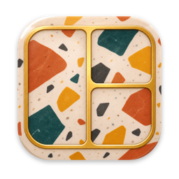
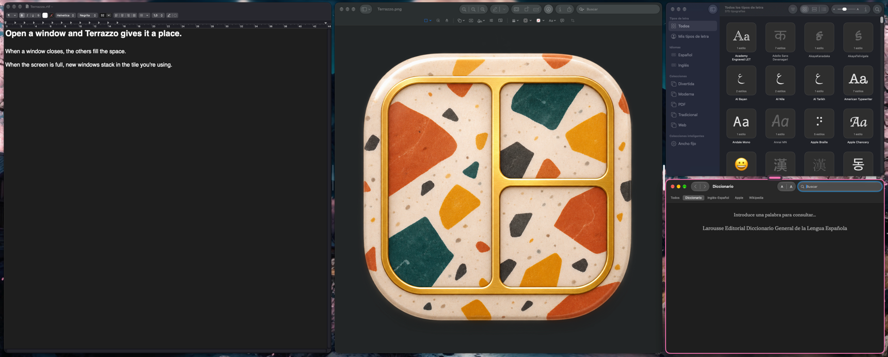

#  Terrazzo

A tiling window manager for macOS. Windows take a place when they open, the rest fill the space when one closes, and extra windows stack in the tile you're using. There's a menu-bar panel and a Settings window, and everything is also a plain file in `~/.config/terrazzo/`.

**Website:** [terrazzo-mac.vercel.app](https://terrazzo-mac.vercel.app), with a live demo of how windows are arranged.



Its numbered workspaces and command line are inspired by [AeroSpace](https://github.com/nikitabobko/AeroSpace), but it is an independent project, not affiliated with it.

## Requirements

- macOS 15 or later
- Accessibility access, granted in System Settings → Privacy & Security → Accessibility
- Xcode, to build it

The app isn't sandboxed, because controlling other apps' windows doesn't work in the sandbox. Releases are notarized. It takes no screenshots and saves no window titles. Its only network connection is to look for updates, which happens when you choose **Check for Updates…** or turn on automatic checks in Settings → About; automatic checks start off.

## Install

```sh
brew install --cask juancasanueva/tap/terrazzo
```

Or download the latest zip from [Releases](https://github.com/juancasanueva/SWIFTUI_Terrazzo/releases/latest). Releases are Apple silicon only. See [RELEASING.md](RELEASING.md) for how a version is published.

## Build and run

Open `Terrazzo.xcodeproj` in Xcode and run the `Terrazzo` scheme, or from a terminal:

```sh
xcodebuild build -scheme Terrazzo -configuration Release -destination 'platform=macOS' -derivedDataPath build/DerivedData
open build/DerivedData/Build/Products/Release/Terrazzo.app
```

The project is signed with its author's team. To build it yourself, set your own team under Signing & Capabilities, or change `DEVELOPMENT_TEAM` in `Terrazzo.xcodeproj/project.pbxproj`.

On first launch a short tour asks for Accessibility access. Nothing moves until its last step, **Tidy My Workspace**.

## Shortcuts

Every shortcut can be changed or turned off in Settings → Keyboard, or in `shortcuts.json`.

| Keys | Action |
| --- | --- |
| ⌃ ←→↑↓ | Focus the window in that direction, or the next monitor |
| ⌃⇧ ←→↑↓ | Swap with the neighbor, or move to the next monitor |
| ⌃⌥ ←→↑↓ | Resize: move the window's edge that way |
| ⌃⌥0 | Reset sizes on this screen |
| ⌃ 1–9 | Switch to that workspace |
| ⌃⇧ 1–9 | Move the active window to that workspace, and follow it there |
| ⌃N ⌃⇧N | Next / previous window in this stack |
| ⌃⇥ ⌃⇧⇥ | Tab View: every window, by screen. Hold ⌃, then release to switch |
| ⌃⌥] ⌃⌥[ | Activate the next / previous window on this screen |
| ⌃⌥↩ | Make the active window primary |
| ⌃T | Float the active window, or tile it again |
| ⌃⌥⇧F | Always float this app |
| ⌃F | Focus mode: fill the screen, or put it back |
| ⌃⌥D | No peek mode: fade everything but the active window |
| ⌃⌥P | Clean Space: put the active window on a plain background |
| ⌃⌥R | Retile |
| ⌃⌥⌘1–5 | Number of windows on this screen |

Shortcuts follow a key's physical position, and they apply in every app while Terrazzo runs.

**Conflicts to expect:**

- macOS uses ⌃ + arrows for Mission Control and for switching Spaces, and takes them first. Turn those off in System Settings → Keyboard → Keyboard Shortcuts → Mission Control.
- ⌃⇥ is how browsers and many apps switch tabs.
- ⌃F, ⌃N and ⌃T move the cursor or swap characters in shells and Mac text fields.

### Mouse

| Action | Result |
| --- | --- |
| ⌘-drag a window onto another | Swap them |
| ⌥⌘-drag a window onto a tile | Add it to that stack |
| Drag a window to another screen | Move it there, if there's room |
| Drag a shared edge | Resize both sides |
| Drag the white handle between two windows | Resize both sides. It stands out when the pointer is on it |
| Click a bar above a stacked window | Show that window |
| Rest the pointer on the bar | Open quick actions and window icons |

## How it works

- **Layouts:** Grid, Columns, Rows and Side, with variations for ultrawide and vertical monitors. Each screen keeps its own layout, window count and sizes.
- **Stacks:** when a screen is full, a new window stacks on the tile you're working in. Focus a window first to choose which tile, or set "When a screen is full" to float new windows instead.
- **Minimum sizes:** an app that refuses to shrink has its minimum learned, and split lines move to make room. If it still doesn't fit, it stacks or floats. Settings → Apps lists these and can forget them.
- **Excluded apps:** untick the app's switch in the menu-bar panel to leave its windows where you put them.
- **Pointer:** the pointer follows focus to the window or monitor you moved to, unless it's already there. Both rules can be turned off.
- **Restarts:** restarting Terrazzo puts windows back in their tiles, stacks and workspaces. macOS gives a window a new number when it's reopened, so this doesn't cover quitting those apps or restarting the Mac.

### Workspaces

There are nine numbered workspaces, separate from macOS Spaces. Each monitor shows one, and the others keep their windows parked in a screen corner, where macOS leaves a small sliver visible. Parked windows come back when Terrazzo quits or is paused. Floating windows and excluded apps stay visible on every workspace. Windows keep their workspace number when a monitor is unplugged: those on a workspace the remaining monitors aren't showing stay parked until you go to that number.

## Configuration

Settings are plain JSON in `~/.config/terrazzo/`, or `$XDG_CONFIG_HOME/terrazzo/`. Edits apply within a moment, and keys you leave out take their default. If a file can't be parsed, Terrazzo keeps its last good values, tells you which file has the error, and won't overwrite it until you fix it.

| File | Holds |
| --- | --- |
| `settings.json` | Layout, spacing, appearance and behavior |
| `shortcuts.json` | The shortcuts you changed |
| `apps.json` | Apps that are never tiled, and learned minimum sizes |
| `screens.json` | Layout, window count and sizes per screen and workspace. They survive unplugging and replugging a monitor |
| `layout.json` | Where windows are, written by the app. Window numbers and app identifiers |
| `run/state.json` | Workspaces for the command line, written by the app. Numbers, monitor positions and app names |

### `settings.json`

```json
{
  "layout": "side",
  "windowsPerScreen": 4,
  "mainSize": "twoThirds",
  "gap": 12,
  "resizeStep": 2,
  "whenFull": "floatInMiddle",
  "movingIntoFull": "stackOnTop",
  "highlight": { "style": "activeBorder", "color": "#FF9500", "width": 3, "cornerRadius": 16 },
  "stackBar": { "color": "#3B82F6", "hoverDelay": 2.5 },
  "movePointer": { "onWindowFocus": true, "onMonitorChange": true },
  "noPeek": { "dim": 50, "blur": true },
  "workspaceDisplays": { "1": "LG", "2": "LG", "7": "Odyssey" },
  "screenEdges": { "top": 50, "left": 0, "bottom": 0, "right": 0 },
  "automaticUpdateChecks": false,
  "onWorkspaceChange": ["/opt/homebrew/bin/sketchybar", "--trigger", "workspace_change", "FOCUSED_WORKSPACE={workspace}"]
}
```

| Key | Meaning |
| --- | --- |
| `layout` | `grid`, `columns`, `rows` or `side`. Unset means Grid, or Rows on vertical monitors |
| `windowsPerScreen` | Default number of tiles per screen, 1 to 5 |
| `mainSize` | `half`, `sixty` or `twoThirds` |
| `gap` | Space between windows, in points |
| `resizeStep` | Percent of the screen moved by one resize press, 0.5 to 25 |
| `whenFull` | `stack` or `floatInMiddle` |
| `movingIntoFull` | `swap` or `stackOnTop` |
| `highlight.style` | `none`, `activeBorder`, `allBorders` or `glow` |
| `highlight.cornerRadius` | Corner radius of the windows being outlined. Standard windows measure about 16 |
| `stackBar.hoverDelay` | Seconds resting on a bar before the panel opens, 0 to 10 |
| `followMovedWindow` | Moving a window to another workspace also goes there, with that window focused. On by default |
| `workspaceDisplays` | Workspace number to part of a monitor's name. It shows there while that monitor is connected |
| `screenEdges` | Space to keep clear on every screen, for bars from other apps. `screenEdgesByDisplay` does it for one display, by its UUID |
| `onWorkspaceChange` | A program and arguments to run when workspaces change. It runs without a shell, and `{workspace}` becomes the current number |

The rest of the settings are in `Terrazzo/Domain/AppSettings.swift`.

### `shortcuts.json`

Keys are `ctrl`, `opt`, `shift` and `cmd` joined with `+`, and `off` disables a shortcut. Action names are the cases of `ShortcutAction` in `Terrazzo/Domain/Shortcuts.swift`.

```json
{ "prefix": "ctrl+opt", "bindings": { "retile": "ctrl+opt+t", "noPeek": "off", "tabView": "cmd+e" } }
```

`prefix` applies to the shortcuts that start with ⌃⌥ in the table above, other than resizing and always-float's own Shift. It can be `ctrl+opt`, `opt+cmd` or `ctrl+shift`. Shortcuts you set yourself don't change with it.

## Command line

The app's binary answers questions and takes commands, so bars such as [SketchyBar](https://github.com/FelixKratz/SketchyBar) can show workspaces. Arguments match AeroSpace's where they overlap, so scripts written for it only need to call a different program.

```sh
TERRAZZO=build/DerivedData/Build/Products/Release/Terrazzo.app/Contents/MacOS/Terrazzo

$TERRAZZO list-workspaces --all
$TERRAZZO list-workspaces --focused
$TERRAZZO list-workspaces --monitor all --format '%{workspace} %{monitor-appkit-nsscreen-screens-id}'
$TERRAZZO list-windows --workspace 3 --format '%{app-name}'
$TERRAZZO workspace 3
```

Floating windows and excluded apps belong to no workspace, so they aren't listed. Combine this with `onWorkspaceChange` to refresh a bar when workspaces change.

## Development

```sh
xcodebuild test -scheme Terrazzo -only-testing:TerrazzoTests -destination 'platform=macOS'
```

| Folder | Contents |
| --- | --- |
| `Terrazzo/Domain` | Layout, workspace state, shortcuts and config. Pure logic, covered by unit tests |
| `Terrazzo/Adapters` | Accessibility, displays and Spaces, global hotkeys, config file watching |
| `Terrazzo/App` | The controller connecting the domain to the system, pointer tracking, the command line |
| `Terrazzo/UI` | Overlays, menu-bar panel, Settings, Tab View and tour |

`_AXUIElementGetWindow` and SkyLight's Space functions are private macOS API with no public equivalent, so a macOS update could affect them. If the SkyLight functions disappear, Spaces are treated as one Space.

## License

[MIT](LICENSE)
